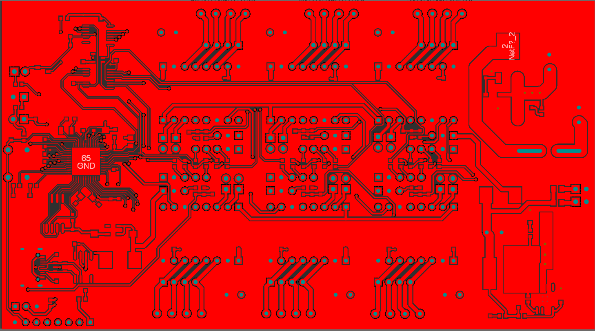

# MIK32 6-axis — контроллер шести шаговых двигателей на MIK32 АМУР

Плата управления шестью шаговыми двигателями на отечественном микроконтроллере RISC-V **MIK32 АМУР (К1948ВК018)**, встроенное ПО и программы для компьютера. Проект выполнен как курсовая работа по дисциплине «Микроконтроллеры» на кафедре 307 МАИ.



## Возможности

- 6 осей: сигналы STEP, DIR, EN; сменные драйверы StepStick (A4988, TMC2208/2209), микрошаг до 1/16.
- Синхронное движение всех осей: плата исполняет их равномерно и одновременно.
- Очередь на 32 отрезка, до 25 000 шагов/с на ось.
- 6 концевых выключателей и аппаратный аварийный останов: кнопка снимает разрешение драйверов независимо от программы.
- Входы для 6 энкодеров MT6701 (SSI, 14 бит, CRC).
- USB-C (CH340N), текстовый протокол, 115 200 бод.
- Питание двигателей 24 В; логика может питаться от USB.
- Управление из браузера (Web Serial) без установки ПО.

## Структура репозитория

```
├── firmware/          встроенное ПО (PlatformIO, C)
│   ├── platformio.ini
│   ├── src/
│   └── README.md      сборка, прошивка, команды, настройки, неисправности
├── hardware/          схема и печатная плата (Altium Designer), Gerber, BOM
│   └── README.md      разъёмы, перемычки, особенности ревизии 1
├── tools/             программы для компьютера
│   ├── web/           пульт управления и плоттер (открываются в Chrome)
└── docs/              статья, презентация, пояснительная записка
```

## Быстрый старт

1. Установите VS Code и расширение **PlatformIO IDE**, откройте папку `firmware/`.
2. Подключите плату по USB-C и программатор J-Link к разъёму XP6.
3. **Build**, затем **Upload** на нижней панели PlatformIO.
4. Откройте `tools/web/jog.html` в Chrome, нажмите «Подключиться» и выберите порт USB-SERIAL CH340.

Подробности — в [`firmware/README.md`](firmware/README.md), особенности платы — в [`hardware/README.md`](hardware/README.md).

## Протокол (кратко)

| Команда | Назначение |
|---|---|
| `M d1 d2 d3 d4 d5 d6 t` | отрезок: ось i делает di шагов за t мс |
| `E` / `D` | включить / выключить драйверы |
| `X` | сброс аварии |
| `Z`, `P p1..p6` | обнулить / задать положения осей |
| `R` | прочитать энкодеры |
| `?` | состояние: `<Idle\|POS:...\|Q:0\|LIM:000000\|EN:1>` |
| `!` | немедленный стоп и очистка очереди |

На каждую строку плата отвечает `ok` или `error: ...`; следующий отрезок отправляется после `ok`.

## Состояние проекта

- Плата изготовлена, прошла модульное и функциональное тестирование; испытана на 3D-принтере (в том числе ось с двумя двигателями).
- Проверены: синхронное движение, микрошаг 1/16, концевые выключатели, аварийный останов, питание 24 В.
- Не проверены: энкодеры MT6701 (датчики не приобретены; чтение реализовано).
- Себестоимость платы при партии 100 шт. — около 4,2 тыс. ₽ (без драйверов, БП и двигателей).

## Авторы

- [Фалелюхин В.А] — [Разработчик]
- [Федоров В.И.] — [Разработчик]

Руководитель: [Коробков М.А., Доцент к.307]. Кафедра 307, Московский авиационный институт, 2026.