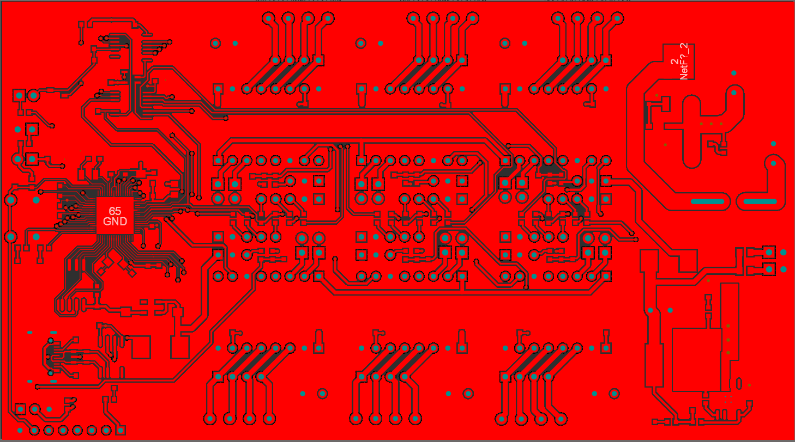
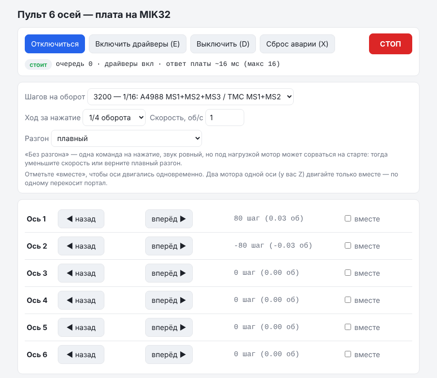
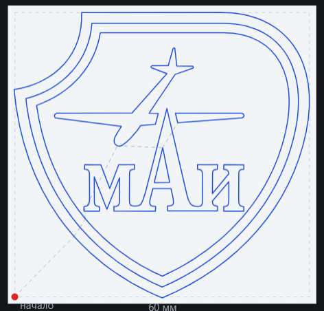

# Контроллер шести шаговых двигателей на отечественном микроконтроллере MIK32

*Студенты кафедры 307 МАИ: [ФИО], [ФИО]. Руководитель: [ФИО, должность].*

Шаговые двигатели применяются везде, где нужно точное перемещение: в 3D-принтерах, станках с ЧПУ, манипуляторах. Распространённые контроллеры для таких устройств рассчитаны не более чем на пять двигателей и построены на зарубежных микроконтроллерах. Для манипулятора с шестью степенями подвижности этого недостаточно, поэтому мы разработали собственный контроллер на шесть осей на отечественной элементной базе.

## Что сделано

Мы спроектировали и изготовили плату на микроконтроллере MIK32 АМУР производства АО «Микрон». Плата подключается к компьютеру по USB и управляет шестью шаговыми двигателями одновременно. Движение всех осей синхронизировано: они начинают и завершают перемещение в один момент, что необходимо для плавной траектории.

*Печатная плата.*

К плате подключаются концевые выключатели, которые останавливают ось при достижении крайнего положения, и кнопка аварийного останова. Аварийный останов работает аппаратно: кнопка отключает двигатели напрямую, независимо от программы. Драйверы двигателей устанавливаются в разъёмы, поэтому их можно заменить или подобрать под конкретную механику. Предусмотрены входы для датчиков положения, которые понадобятся для манипулятора.

## Программное обеспечение

Для работы с платой написаны две программы, которые запускаются в браузере и не требуют установки.

Пульт управления служит для ручного перемещения осей, выбора скорости и режима разгона. В нём есть демонстрационный режим: несколько осей синхронно описывают окружность.

Плоттер строит по векторному изображению траекторию пера с обводкой контуров и штриховкой заливок. Пользователь задаёт размер рисунка и высоту касания листа. С его помощью был нарисован логотип МАИ.

## Испытания

Плата проверялась в три этапа: без микроконтроллера и питания, с питанием без микроконтроллера и после его установки. Такой порядок исключал риск повредить микроконтроллер при возможной ошибке монтажа в цепях питания.

Итоговые испытания проведены на 3D-принтере. Плата управляла всеми его осями, включая ось с двумя двигателями, которые должны вращаться строго синхронно. Концевые выключатели и аварийный останов отработали корректно.

## Стоимость

При выпуске партиями по 100 штук себестоимость одной платы составляет около 4,2 тыс. рублей. Основная часть приходится на микроконтроллер, поэтому при закупке напрямую у производителя стоимость заметно снизится.

## Планы

Далее планируется подключить датчики положения звеньев и собрать на базе платы учебный шестиосевой манипулятор на отечественной элементной базе.